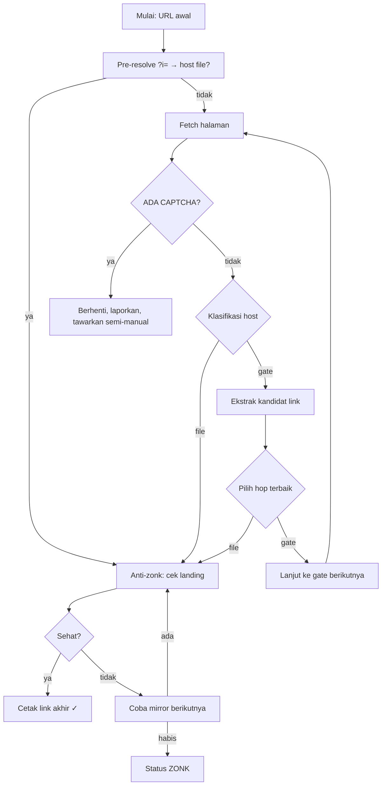

# Laporan Proyek — True Link Finder Helper

**Versi:** 1.0.0
**Tanggal:** 24 Oktober 2026
**Status:** Implementasi selesai, teruji (29 unit test offline), demo live berhasil.

---

## 1. Ringkasan Eksekutif

**True Link Finder Helper** adalah perangkat lunak CLI + web untuk mengikuti
**rantai halaman download perantara** (contoh: `neosatsu.com` →
`linkuzu.blogspot.com/?i=...` → host file akhir) sampai menemukan **link tujuan
akhir yang siap download dan tidak zonk**.

Karakteristik utama:

- **Deterministik** — tanpa AI/LLM, tanpa API berbayar, tanpa key.
- **Murni Python** — `requests` + `beautifulsoup4` + `pyyaml`. (Playwright opsional.)
- **Anti-zonk** — cek kesehatan halaman landing host; auto-fallback antar mirror.
- **Aman/etis** — tidak pernah menyelesaikan CAPTCHA, tidak login, tidak auto-download.
- **Multi-sajian** — CLI lokal, web live (Vercel, mode hybrid anti-timeout),
  dan report statis (GitHub Pages).

---

## 2. Tujuan & Masalah yang Diselesaikan

| Masalah | Solusi |
|---------|--------|
| Rantai download berlapis & berubah-ubah | Parser statis + decoder base64/`czo`/`?i=` yang dikonfigurasi lewat `config.yaml` |
| Link akhir **zonk** (mati/hapus/kedaluwarsa), harus cari manual di host/kualitas lain | `LandingHealthChecker` + auto-fallback antar mirror |
| Halaman yang link-nya muncul setelah JS/timer | Backend Playwright opsional (`--browser`, `--headful`) |
| Mode web online yang sering timeout | Arsitektur **hybrid**: server kerja per-halaman, browser yang orkestrasi |
| Banyak URL (satu musim) | Mode batch → `results.csv` → HTML report statis |

---

## 3. Arsitektur Komponen

```mermaid
graph TD
    subgraph CORE["Inti Python — true_link_finder.py"]
        CLI[CLI (argparse)] --> SOL[Solver / pelacak rantai]
        SOL --> FETCH[StaticFetcher (requests)]
        SOL --> CHK[LandingHealthChecker]
        SOL --> EX[Ekstraktor Kandidat]
        EX --> DEC[Decoder: base64 berlapis]
        EX --> DEC2[Decoder: pola czo]
        EX --> DEC3[Decoder: parameter ?i=]
        CFG[config.yaml] --> SOL
        BROW[BrowserFetcher opsional (Playwright)] --> SOL
    end

    subgraph WEB["Lapisan Web (opsional)"]
        FE[Frontend public/] --> API[API Vercel — api/index.py]
        API --> P[POST /api/probe]
        API --> C[POST /api/check]
        API --> R[POST /api/resolve]
        P --> SOL
        C --> CHK
        R --> SOL
    end

    subgraph REPORT["Lapisan Laporan"]
        CSV[results.csv] --> MR[tools/make_report.py]
        MR --> HTMLR[report/index.html]
    end

    subgraph CI["CI / Deploy"]
        WF[GitHub Actions — report.yml] --> CSV
        WF --> HTMLR
    end
```

**Komponen inti:**

| Komponen | Tanggung jawab |
|----------|----------------|
| `Solver` | Loop utama: fetch → klasifikasi host → ekstraksi → pilih hop → anti-zonk |
| `StaticFetcher` | Fetch HTTP statis (session reuse, User-Agent, timeout) |
| `LandingHealthChecker` | Cek kesehatan halaman landing host (status HTTP + penanda zonk) |
| `extract_candidates` | Kumpulkan semua kandidat link dari HTML |
| `decode_obfuscated_host_id` | Dekode pola `czo` (`XXXczoXXXv<base64 path>`) |
| `decode_gate_param` | Dekode `?i=<base64>` dari URL gate (short-circuit, tanpa fetch) |
| `BrowserFetcher` | (Opsional) jalankan JS/timer/klik via Playwright |

---

## 4. Diagram Deployment

```mermaid
graph LR
    subgraph LOCAL["Lingkungan Lokal"]
        U[Pengguna] --> CLI[CLI: true_link_finder.py]
        U --> LS[Local Server: local_server.py (localhost:8080)]
        LS --> FE
    end

    subgraph VERCEL["Vercel (free tier)"]
        API[Function: api/index.py]
        PUB[Static: public/]
    end

    subgraph GH["GitHub"]
        REPO[Repositori]
        ACT[Actions: report.yml]
        PAGES[GitHub Pages: report/]
    end

    CLI --> NET[Internet: situs gate/host]
    API --> NET
    LS --> NET
    FE --> API

    REPO --> ACT
    ACT --> PAGES

    style NET fill:#fff,stroke:#666,stroke-dasharray:4 4
```

**Penjelasan:**

1. **CLI lokal** — pemakaian utama; jalan di mesin pengguna, akses internet langsung.
2. **Vercel** — function Python `api/index.py` (endpoint probe/check/resolve)
   + frontend `public/`. Deployment via `vercel.json`.
3. **GitHub Actions** — workflow `report.yml` menjalankan batch dan
   menghasilkan `report/index.html`, lalu deploy otomatis ke GitHub Pages.
4. **Local server** — `local_server.py` (stdlib HTTP) untuk uji coba
   frontend + API tanpa perlu deploy.

---

## 5. Alur Kerja

### 5.1 Alur resolver (CLI / API `resolve`)



### 5.2 Alur web hybrid (anti-timeout)

```mermaid
sequenceDiagram
    participant B as Browser (frontend)
    participant A as API (probe/check)
    participant N as Internet

    B->>A: POST /api/probe {url}
    A-->>A: short-circuit ?i= (jika ada)
    alt ada direct
        A-->>B: {direct: hostURL}
    else
        A->>N: fetch 1 halaman
        N-->>A: HTML
        A-->>B: {cls, files[], next, captcha}
    end
    B->>A: POST /api/check {mirror}
    A->>N: fetch landing host
    N-->>A: status + HTML
    A-->>B: {status: ok/bad}
    B-->>B: pilih mirror sehat; lanjut hop (delay di klien)
```

**Kunci anti-timeout:** server hanya mengerjakan **satu halaman per request**
(< ~3 detik), sedangkan loop rantai & delay berjalan di browser. Dengan itu
tidak ada session server yang melewati batas 10 detik free tier.

---

## 6. Data & Konfigurasi

`config.yaml` (mudah diedit tanpa ubah kode):

- **hosts.file** (24 host): Google Drive, Mega, Mediafire, Pixeldrain, GoFile,
  Terabox, Dropbox, dan lain-lain → klasifikasi sebagai **tujuan akhir**.
- **hosts.gate** (7 gate): linkuzu, neosatsu, kolomdownload, ngefilm, movieku,
  anoboy, oploverz → diikuti sebagai **rantai perantara**.
- **options.captcha_markers** (10 penanda): turnstile, hCaptcha, reCAPTCHA,
  Cloudflare challenge, dll.
- **options.health_bad_markers** (16 penanda): `file not found`, `deleted`,
  `expired`, `file tidak ditemukan`, dll → dipakai anti-zonk.

**Hasil batch — `results.csv`:**

| Kolom | Arti |
|-------|------|
| `url_awal` | URL masukan |
| `url_akhir` | Link tujuan akhir |
| `host` | Host file akhir |
| `status` | `ok` / `zonk` / `captcha` / `no_link` / `error` |
| `alasan` | Catatan / detail kegagalan |

---

## 7. Keamanan & Etika

- **Tanpa AI/token**: tidak ada panggilan LLM atau API berbayar; seluruh logika
  adalah kode deterministik.
- **Tanpa menembus CAPTCHA**: jika terdeteksi, tool berhenti + menawarkan mode
  semi-manual (pengguna menyelesaikan di browser, lalu melanjutkan dari URL
  sesudahnya).
- **Tanpa kredensial/login**.
- **Tanpa auto-download**: hanya resolve & mencetak link.
- **Polite scraping**: delay 1–2 detik antar request, `max-depth` dibatasi.

---

## 8. Pengujian

- **29 unit test offline** lulus (fixture HTML simpanan, tanpa akses jaringan).
- Lingkup tes: helpers (host, b64, decode berlapis, decoder `czo`),
  klasifikasi host, ekstraksi kandidat, deteksi CAPTCHA, solver offline,
  fallback anti-zonk, decode parameter gate.
- **Uji live** (URL nyata):

| Masukan | Hasil |
|---------|-------|
| `neosatsu.com/2026/08/kamen-rider-my-th-sub-indo.html` | `ok` → gofile `https://gofile.io/d/CwxOktYI` |
| `linkuzu.blogspot.com/?i=...` | `ok` → gofile `https://gofile.io/d/7KSBhnrp` (short-circuit, 0.02 dtk) |

---

## 9. Batasan

- Cek kesehatan anti-zonk berbasis **halaman landing**, bukan verifikasi byte
  penuh (tidak mendeteksi file yang rusak di tengah, tanpa unduh).
- Parser statis bergantung pada pola situs; jika pola berubah, perlu pembaruan
  kode/`config.yaml`.
- Beberapa situs memblokir IP datacenter → di mode web bisa gagal meski jalan lokal.
- CAPTCHA tidak pernah diselesaikan secara otomatis.

---

## 10. Berkas Proyek

```
true-link-finder/
├── true_link_finder.py    # CLI inti (solver, decoder, anti-zonk)
├── config.yaml             # aturan host & pola
├── local_server.py         # server lokal (stdlib) untuk uji coba web
├── requirements.txt        # requests, beautifulsoup4, pyyaml
├── vercel.json             # konfigurasi deploy Vercel
├── api/index.py            # serverless function (probe / check / resolve)
├── public/                 # frontend web
├── tools/make_report.py    # generator report HTML statis
├── .github/workflows/report.yml  # GitHub Actions → GitHub Pages
├── tests/                  # unit test + fixture HTML
├── README.md
└── DEPLOY.md
```

---

## 11. Roadmap / Lanjutan

- [ ] Caching hasil resolve (KV) agar repeat live instan.
- [ ] Preferensi kualitas (1080p dulu) saat memilih mirror.
- [ ] Flag `--all` untuk mencetak semua mirror sehat.
- [ ] GitHub Action lengkap dengan notifikasi & jadwal.
- [ ] (Opsional) pengujian Playwright untuk situs JS-only.
